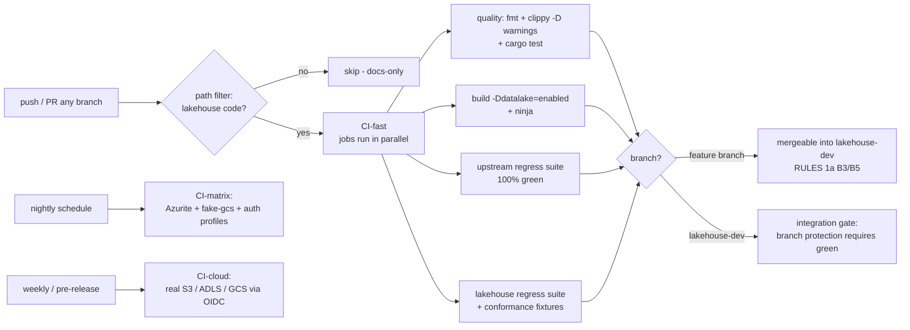

# 10 — Testing Strategy

## 1. Environment matrix

| Tier | Stores | Catalogs | Runs where |
|---|---|---|---|
| **CI-fast** (every commit, < 20 min) | SeaweedFS S3 (docker; see Superseded note below), file:// | REST (in-process Lakekeeper container), Hadoop on local FS | GitHub Actions |
| **CI-matrix** (nightly) | SeaweedFS S3 + Azurite + fake-gcs-server | REST × profiles (generic, Nessie REST, Polaris-style auth mock), Glue (emulated via moto), Hadoop | GitHub Actions nightly |
| **CI-cloud** (weekly / pre-release) | real S3, ADLS Gen2, GCS | real Glue, real Nessie, Polaris sandbox, S3 Tables | org cloud account, secrets via OIDC federation |

Azurite and fake-gcs-server are mandatory parity targets — cloud-only code paths
(auth, listing semantics, checksum headers) must be exercised in CI-fast, not
just in cloud runs.

*(Superseded 2026-11-19: the CI fixture S3 store was originally MinIO. MinIO
deleted its Docker Hub images in Sept 2026 and quay.io now requires auth for
anonymous pulls, so CI-fast/CI-matrix use **SeaweedFS S3** (`chrislusf/
seaweedfs`, upstream first-party image) with the same fake access keys and
endpoint override. Production support for real MinIO deployments is unchanged
— it is plain S3 API with endpoint override (doc 04 §); only the *docker
fixture* swapped. Revisit if Iceberg workloads hit SeaweedFS-specific gaps
(listing semantics, checksum headers).)*

### 1a. CI/CD strategy — pipelines, gates, coverage (amended 2026-11-20)

**Pipeline map** (what runs, where, on what trigger):



**Gate tiers** (what blocks what):

| Tier | Trigger | Contents | Blocking? |
|---|---|---|---|
| **quality** | every push (any branch, path-filtered) | `cargo fmt --check`, `cargo clippy -D warnings`, `cargo test` | **yes** — a style/lint red blocks merge before any build minute is spent |
| **CI-fast** | every push (any branch, path-filtered) | build + upstream regress + lakehouse regress | **yes** |
| **CI-matrix** | nightly on `lakehouse-dev` | full store/auth matrix (§1) | no (alert + fix-next-day contract) |
| **CI-cloud** | weekly + pre-release | real cloud stores (§1) | yes for releases |
| **coverage** | nightly on `lakehouse-dev` | Rust `llvm-cov` on pgdatalake-core, C `gcov` on lakehouse dirs, scoped to the lakehouse suites | **no** — trend artifact, threshold alarms only (see below) |
| **sanitizers** | nightly on `lakehouse-dev` | ASAN/UBSAN build of the lakehouse suites; valgrind one-shard sampling | no, but any sanitizer finding is a **P1 defect** (this class of bug = silent corruption, see 13-review incident) |

**Design rules** (why it looks like this):

- Fail fast and cheap first: the quality job runs in parallel but before the
  docker fixtures come up; a fmt/lint failure costs seconds, not a 10-minute
  build.
- Path filtering keeps docs-only pushes at zero build cost, but NEVER gate
  feature-branch CI on branch name — every branch that can merge is a branch
  that must be tested (RULES §1a).
- Upstream's regress suite stays in CI-fast: a fork that breaks upstream
  behavior fails even when lakehouse tests pass (RULES §9).
- Coverage: scoped to lakehouse code only (fork delta — upstream code coverage
  is upstream's own CI problem). Threshold model: **ratchet, not cliff** — the
  nightly job records line/branch coverage per crate/directory and alarms when
  it drops below the last accepted value; no hard CI-fail until the trend is
  stable, then the ratchet becomes the gate. New slices must include their
  tests in the same commit (RULES §8), which is what keeps the ratchet moving
  up.
- Sanitizer nightlies exist because the M3-R1 incident (silent tombstone
  corruption) was caught by live verification, not by tooling — the class of
  defect that must never rely on luck again.
- The validity rule (RULES §1a): only `gh run list --workflow datalake-ci`
  output counts as green; upstream "CI for PostgreSQL" runs are no-ops here.

## 2. Conformance suite (the acceptance bar)

- **Iceberg spec conformance**: port the official `iceberg-python`/`iceberg-go`
  integration test corpus: table lifecycle, all type round-trips, all partition
  transforms, schema evolution sequences, snapshot expiry, v2 position/equality
  delete application, v3 deletion vectors (slice V1/V2 in doc 14;
  pyiceberg `format_version=3` fixtures — it defaults to 2). Run the *same fixtures* written by
  PyIcepire/Spark and read by us, and vice versa (write by us, read by PyIceberg).
- **REST catalog conformance**: the REST spec's official conformance suite
  (namespacing, config resolution order, commit requirements, token refresh).
- **Interop gates (must pass before any release)**:
  - Trino reads a table we wrote (all types, partition transforms, after compaction).
  - PyIceberg reads our DVs (merge-on-read output).
  - We read a Spark-written table with eq-deletes.
  - We read a table written by Trino with zstd/lz4/gzip/snappy/none codecs.

*(Slice 22 status, 2026-11-19.)* The **Trino writer fixture** is part of the
compose stack now (`docker compose -p pgdatalake up -d trino`, profile
`trino`, REST catalog over Lakekeeper; config in
`fixtures/trino-catalog.properties`). Verified live for the M1 gate:
Trino-written day-partitioned table (bigint/varchar/decimal/timestamp/
boolean) reads correctly through the FDW **including Trino's MoR
position-delete file** (Trino DELETE + our delete application agree with
Trino's own counts), and snapshot time travel matches Trino's view of
each historical snapshot. Interop fix required: Trino writes
single-valued optional manifest fields (e.g. `sort_order_id`) as plain
`Int` inside the Avro union — the manifest parser accepts that alongside
pyiceberg's shapes. Outstanding gate variants: Spark-written eq-deletes
(eq path is unit-covered), Trino codec matrix, and "Trino reads a table
we wrote" (needs our M2 writer).

*(M1 gate status, 2026-11-19: read-half conformance green on PyIceberg
fixtures incl. full type matrix; Trino-written table queryable incl. MoR
position-delete application; TPC-DS q1–q10 all execute with 0 errors —
pruning evidence 18,240 examined / 18,230 pruned, full-scale timings q1
1.2s / q2 18.0s / q3 recorded as a >60-min row-transport bottleneck with
fix path (columnar batch reads, M2 slice 24); evidence ledger at
`src/test/lakehouse/fixtures/gate-evidence-m1-tpcds.md`. Outstanding
gate variants deferred: Spark-written eq-deletes (unit-covered), Trino
codec matrix, "Trino reads a table we wrote" (M2).)*

## 3. PostgreSQL regression suites

- `src/test/regress/lakehouse/` — SQL/expected pairs (join iceberg vs heap,
  EXPLAIN plans, time travel, type matrix, error cases with SQLSTATE checks).
- isolation tests (`src/test/isolation/lakehouse/`) — concurrent DML commit races
  (AssertRefSnapshotId retry paths), RR pinning, overlay visibility, compaction
  vs DML.
- `TAP` tests for bgworker maintenance, crash recovery (kill -9 between commit
  stages from doc 07 §2, verify orphan/reconcile outcomes).

## 4. Property-based / adversarial

- **Crash-point fuzz**: instrumented fault injection at every object-store call
  (fail Nth request with 500/timeout/slowdown) — the recovery invariants from
  doc 07 must hold: no partial visibility, no unbounded retry storms, orphans
  always collectable.
- **Metadata fuzz**: malformed metadata.json / manifest / footer → clean ERROR
  with file path + json-pointer location, never a crash (libFuzzer targets in the
  Rust core for the serde paths; oss-fuzz job in M3).
- **Concurrency fuzz**: multi-client random DML/DDL/maintenance against one table
  via psql sessions, assert Iceberg spec invariants post-hoc with PyIceberg audit
  (every committed snapshot valid, no orphaned commits).

## 5. Performance gates (block release)

| Metric | Gate |
|---|---|
| Scan throughput 1-column predicate, 10GB table, fixture S3 local | ≥ 60% of DuckDB-on-S3 single-node baseline |
| Point INSERT commit latency (1 row, warm catalog) | < 150ms p50 against the fixture S3 |
| 1000-batch bulk load (10M rows) | ≥ 50 MB/s/backend into the fixture S3 |
| Compaction 500 small files → 50 | < 5 min, 8 workers |
| Parallel scan scaling | ≥ 5× on 8 workers vs 1 (task-parallel table) |
| Metadata planning on 2000-manifest table | < 300ms warm |

Regressions > 10% on two consecutive runs block merge; `perf/` directory holds
the harness (`make perf-lakehouse`).

### 5.1 Cross-engine reference numbers (proximaDB, 2026-11-20)

Same fixture as our TPC-DS gate (SeaweedFS, SF=10, store_sales 73-file
bin-packed layout; row counts verified against duckdb goldens; fresh
server + wiped catalog per route, warmup + 3 measured runs, median,
release builds, same machine). Delivered by the proximaDB session
(proximadb-e4); recorded here as the shared-fixture reference point
(M1 numbers are our release-build FDW runs):

| query | proximaDB native (pgwire) | DuckDB wrapper (pgwire) | stock DataFusion 55 (ListingTable) | postgres FDW (M1 gate) |
|---|---|---|---|---|
| q1 | 1.759s | 2.412s | 0.139s | 1.2s |
| q2 | 0.788s | 1.472s | 0.194s | 18.0s |
| q3 | 0.471s | 1.171s | 0.117s | >12min unfinished |

Reading: proximaDB native beats the FDW everywhere except q1; q3 goes
from >720s-unfinished to 0.47s — consistent with our retro finding #1
(row-by-row transport is THE bottleneck; columnar batch reads fix it).
Addendum from proximadb-e4 (measured, head-on): the per-query open
overhead (pgwire + LIST + 73 HEADs + footers) is only ~0.17s on the
native route — NOT the main native-vs-stock-DF gap driver (q1: 1.759
vs 0.139s leaves ~1.6s in the scan/compute operators). The real
proximaDB optimization target is the scan path itself (bloom semi-join
gate, io-trace wrapper, StatsTrust::Untrusted disabling footer elision
for external locations). Our analogous lever stays retro #3
(remote parameterization / hash-subplan conversion for correlated
subplans). proximaDB's side: TD-OLAP-4, branch
feat/external-table-df-exec.

### 5.2 INTERNAL receipts — post perf-fix #1 read-path state (2026-11-21)

NOT a marketable benchmark: single run, in-flight measurements, no
protocol polish yet. Recorded as ENGINEERING evidence for the next
slices (P0b4 etc.). Same fixture as §5.1 (TPC-DS SF=10, store_sales
73 files), release build (parquet/arrow 60.1.0 + object_store 0.14.2
+ P0b ranged/cached opens), fresh instance, postgres-native diagnosis:

- `EXPLAIN (VERBOSE) SELECT count(*) FROM store_sales`: the Parallel
  Foreign Scan's Output list carries **ALL 23 columns** — count(*)
  materializes and transports 28.8M rows × 23 columns across the FDW
  boundary; the aggregate sits ABOVE the scan.
- `pg_stat_activity`: 3 backends (leader + 2 parallel workers) all
  `active` with **empty wait events** — 100% CPU in row decode/
  transport, 0% blocked on I/O. The fetch side (P0b) is NOT the
  bottleneck anymore; executor-side transport is.
- Full-table `count(*)` measured ~12 min (row transport); with an
  empty projection P0b's ProjectionMask already fetches no column
  chunks — elision (P0b4, spec 15 §6.6) removes the transport too by
  answering from manifest record_counts (exact for this snapshot).
- q1/q2-class queries (predicate-pruned, small results) are expected
  to show the batch-ABI + P0b wins; the q3-class full-scan canary
  remains gated on executor-side aggregation (P0b4/P0b3).

Marketed §5.1-style comparison table: deferred until the P0b4 +
P0b3 slices land and a clean warmup+3 protocol completes.

## 6. Developer loop

```bash
make lakehouse-up          # docker compose: SeaweedFS s3 + lakekeeper + azurite + fake-gcs
make lakehouse-check       # cargo test -p pgdatalake-core + regress lakehouse subset
make lakehouse-conformance # interop suite vs pyiceberg (uv-managed venv)
make lakehouse-down
```
All fixtures in `src/test/lakehouse/fixtures/`, no network at unit-test time.

These root targets are forwarded to `src/test/lakehouse/` by a small block in the
root `Makefile` (`[core-allowlist]`, 2026-11-19) — it is only reachable in
meson-only trees (no `GNUmakefile`), which is the supported build mode; see
RULES.md §9 for the meson-vs-autoconf note.

### Write-staging serialization decision (2026-11-20)

Question raised in review follow-up: should the managed-write row
transport (C → Rust staging) use MessagePack or another binary format
instead of the typed JSON array?

**Measured** (`bench_write_push_json_throughput`, release, 5-column
rows, 100k): full JSON pipeline (serde parse → typed cells → arrow
builders) = **2.34M rows/s (11.7M cells/s)**; arrow-append floor =
7.16M rows/s. Per-row staging cost ≈ 430 ns.

**Decision: keep the typed JSON array.** The staging step runs at ~
2.3M rows/s while the pipeline's dominant costs are per-FLUSH (S3 PUT
≈ ms) and per-COMMIT (catalog RTT ≈ ms) — and the READ path's row-by-
row transport measured ~2.7k rows/s at M1 (q3, slice-24 target), three
orders of magnitude slower. A binary format (MessagePack included) buys
≤ 2-3× on a step that is <1% of pipeline time, costs a new dependency
(rmp-serde still builds a DOM unless hand-rolled), and forfeits the
debuggability that made the #8b correctness fixes easy to verify.
MessagePack specifically is NOT the better choice: it keeps the DOM
allocation profile while dropping readability.

Re-visit triggers: a scaled write benchmark (M4 perf gate) showing
staging >5% of pipeline, or the columnar-batch staging refactor
(natural home for a typed binary row format if one lands). The bench
stays `#[ignore]`d for explicit re-runs.
