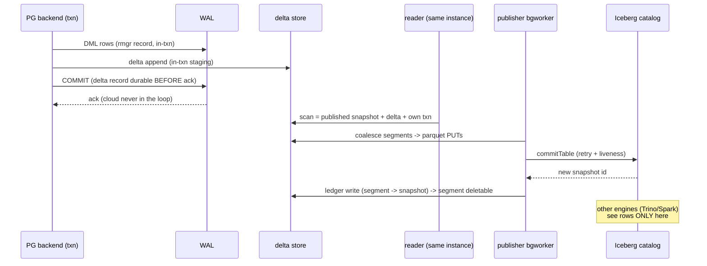
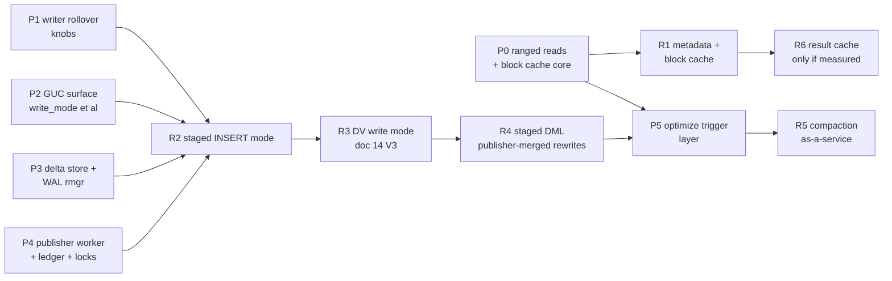

# 15 — Staged Writes (Delta + WAL Durability), Background Compaction, and Caching

*(2026-11-20. SPEC-ONLY by direction: design and cross-review now,
implementation deferred. Motivation: M2's per-transaction COW commit
forces every UPDATE/DELETE to rewrite base files synchronously and every
commit to make remote PUTs — correct, but it caps write throughput,
manufactures small files, and pins commit latency to the cloud RTT.
This doc specifies a durable staged-delta layer between PG commits and
Iceberg commits, a background compaction/publish thread, and a read
caching tier — deliberately exploiting Postgres' stability (WAL
machinery, crash recovery, physical replication, buffer management)
instead of rebuilding it in the storage layer.)*

## 1. Problem statement and goals

Today (docs 06 §3, 07 §2): each committing transaction pushes its staged
rows and COW rewrites to object storage, builds a snapshot, and commits
to the REST catalog **synchronously inside PRE_COMMIT**. Consequences:

| # | Symptom | Root cause |
|---|---|---|
| P1 | Small-file proliferation | one file-set per transaction (doc 08 small-file trigger already fires at n_inserted_batches ratio 0.5) |
| P2 | Write latency = cloud latency | S3 PUT + manifest/list write + REST commitTable in every commit |
| P3 | Write amplification | every UPDATE/DELETE rewrites its base file (COW), even for single-row DML |
| P4 | Bursty PUT volume | concurrent backends PUT independently; no coalescing |
| P5 | Cold reads | every scan GETs metadata + parquet bytes; nothing exploits temporal locality |

**Goals.** G1: commit latency decoupled from remote publish (bounded,
measurable). G2: durable through PG crash (WAL-grade: committed DML is
never lost or half-visible). G3: coalesced, size-bounded file emission
(small-file problem prevented, not just repaired). G4: reads merge
unpublished deltas correctly — never misread (doc 14's governing
principle applies to the delta layer too). G5: other engines' visibility
lag is explicit and operator-controlled, never silent-forever. G6:
caching layers that are safe *because of* Iceberg immutability, with no
invalidation-on-write machinery at all.

**Non-goals.** Cross-engine concurrent delta visibility (publish closes
the gap); transactional guarantees beyond PG's own for the delta;
replacing PG WAL for PG-native objects; write path for external tables
(unchanged: FDW reads only).

## 2. Architecture overview

Four cooperating pieces, layered so each is independently shippable:

```
         ┌────────────────────────────────────────────────────┐
SQL DML →│ A. Staged-delta layer (per-table durable delta)    │  ← PG commit is
commit → │    WAL-logged via a custom resource manager        │    now fsync-WAL
         ├────────────────────────────────────────────────────┤    cheap + local
         │ B. Publisher thread (dynamic bgworker, per table)  │  → Iceberg:
         │    coalesces deltas → files/DVs → REST commitTable │    async, batched
         ├────────────────────────────────────────────────────┤
         │ C. Compaction thread (doc 08 lakehouse.optimize    │  → rewrite-based
         │    exec mode, run as a service)                    │    maintenance
         ├────────────────────────────────────────────────────┤
reads →  │ D. Read path: buffer cache → local block cache →   │  ← immutable-
         │    object store (existing scan pipeline)           │    path caching
         └────────────────────────────────────────────────────┘
```

A is the foundation; B depends on A; C is doc 08's already-designed
optimizer running continuously instead of on-demand; D is additive.

**Commit → visibility timeline (staged INSERT mode):**



## 2a. Seam conformance: build on Postgres, or justify the delta (2026-11-20)

*(Review question: is every capability here built on a battle-tested
Postgres subsystem, or are we inventing a parallel one? All facilities
cited below were verified present in this tree.)*

| Capability | Postgres subsystem we ride on | Verdict |
|---|---|---|
| delta durability | **plain catalog tables**: a committed transaction's INSERT of its delta segment is WAL-fsynced at COMMIT by the machinery that has logged every row since 1987; crash recovery, physical replication, basebackup, checksums — all inherited, zero new code | ✅ PG-native (see D1-rev) |
| crash visibility of staged rows | PG recovery restores the delta table like any table | ✅ |
| publish idempotency ledger (§4.4) | the delta row itself carries `published` + `published_snapshot_id` columns — a ledger file is unnecessary; UPDATE visibility via MVCC | ✅ PG-native |
| publisher / compactor processes | **dynamic background workers** (`postmaster/bgworker.h`, `WaitLatch` sleep/wake) — the autovacuum model: launcher + workers, `cost_limit`-style I/O throttling borrowed from `autovacuum_vac_cost_delay` | ✅ PG-native |
| shared coordination (work queue, leases) | shared hash + `dsa`/`shm_toc` primitives bgworkers already use | ✅ PG-native |
| temp/spill files | `BufFileCreateFileSet` / `FileSet` (`storage/buffile.h`) — never hand-rolled file management | ✅ PG-native |
| read caching (in-process) | per-backend LRU in the Rust core (P0, landed) | ⚠ justified delta — see C1 |
| read caching (shared disk, v2) | `SharedFileSet` + `dsa` for cross-backend coordination | ✅ PG-native (v2 plan) |
| WAL alternative channels | logical decoding messages (`replication/logical.h`): evaluated, **rejected** for delta durability — see D1-rev rationale | recorded |

**D1-rev (supersedes D1, 2026-11-20 — per RULES §7): the delta store is a
Postgres TABLE, not custom WAL records and not segment files.**

- Original D1: custom rmgr (`RegisterCustomRmgr`, verified at
  `rmgr.c:107`) logging delta records, replayed at startup into a
  hand-managed segment store under `pg_lakehouse/delta/`.
- What broke in review: EVERYTHING the rmgr bought is what a plain
  INSERT inside the committing transaction already provides —
  WAL-fsync-at-commit ordering, crash replay (the row IS the durable
  record; recovery restores it), physical-standby inheritance. The
  custom route then adds three hand-rolled subsystems PG already owns:
  replay (redo callbacks), segment fsync/enumeration, and a ledger
  file — each a correctness surface the delta-as-table design deletes.
- The rmgr route is RETAINED as a recorded alternative for one
  scenario only: if measured delta-INSERT overhead (buffer-manager +
  TOAST traffic) materially regresses bulk staged loads, a rmgr writing
  pre-serialized batch payloads (one record per flush, not per row)
  becomes the escalation — with the crash tests of §7.2 P3 as the
  identical acceptance bar either way.
- Logical decoding was evaluated as the other "PG WAL" channel and
  rejected: its delivery semantics are consumer-driven (slot retention,
  lost on slot drop), it requires `wal_level=logical` WAL amplification,
  and — decisively — it does not participate in crash RECOVERY (the
  delta would be decodable-but-not-replayed exactly when G2 needs it).

**C1 (justified delta — the read cache is not a parallel buffer pool).**
Postgres's buffer manager is a page-cache for relations going through
smgr; lakehouse bytes come from object stores over HTTP(S) via
`object_store`, in file formats with no page structure. Routing them
through shared_buffers would mean fake relations + smgr games — a
fragile inversion of the seam. The cache therefore lives in the layer
that performs the I/O: per-backend LRU in the Rust core (landed, P0),
promoted to a shared disk cache on `SharedFileSet` + `dsa` (both
verified in-tree) only when measurement shows multi-backend locality
matters. The OS page cache already covers local-FS (`file://`) reads —
our cache earns its keep specifically on network object-store reads.

## 3. A — the staged-delta layer

### 3.1 Representation

Per managed table, an in-instance **delta** logically partitioned by
commit: `{inserted rows, tombstoned (file, row-pos) pairs}`. Content is
exactly what slice 28 already accumulates in memory (LakehouseWriteEntry
staged_values + tomb_files) — this slice generalizes it from
transaction-lifetime to committed-but-unpublished lifetime, and makes it
durable.

Row encoding reuses the writer's row-JSON (write path, doc 06 §4) — the
publisher must re-encode only once, at file emission; the delta stays
typed-binary (the staged accumulator's existing representation) so
re-reads never re-parse text.

### 3.2 Durability: a custom WAL resource manager (the load-bearing decision)

**Decision D1** *(SUPERSEDED by D1-rev, §2a — the delta store is a
Postgres table; the rmgr route below is the recorded alternative kept
for the measured-escalation scenario only)*. Delta records go through **Postgres WAL via a custom
resource manager (RM_LAKEHOUSE_ID)**, not a bespoke sidecar log.

- A commit that staged N rows / T tombstones emits one delta WAL record
  (rmgr ID from the core-allowlist rmgr table — the only core-adjacent
  edit; feasibility pre-checked: `RmgrIds` reserve a slot for extensions
  via RM_MAX_ID, custom rmgrs are a supported custom-WAL facility in
  the resource-manager lineup of this tree).
- PG's existing commit machinery then provides, for free, exactly what
  a hand-rolled WAL would have to re-earn: **fsync-at-commit ordering**
  (the delta is durable before COMMIT acks), **crash recovery** (startup
  replay reconstructs every unpublished delta — G2), **physical
  replication** (standbys replay deltas, so a promoted standby inherits
  the delta — no operator procedure), and **PITR** (restore point
  includes staged state).
- Records larger than `XLogRecordMaxSize` chunk (records are chunked by
  XLogInsert machinery; the redo function reassembles — same contract
  bulk WAL records already follow).
- **Redo semantics:** replay appends the delta to the on-disk delta
  store (§3.3). Undo does not exist (deltas are never rolled back; the
  transaction's own abort never wrote one — abort still prunes in-memory
  staged state exactly as today).

**Rejected alternative (recorded):** sidecar fsync'd log per table in
PGDATA. Rejected because it re-implements replay, replication shipping,
and fsync ordering that PG gives free; risks divergence between the
sidecar and WAL during crash-recovery edge cases; and adds a second
durability surface to secure (RULES §6: the sidecar would carry row
data, not credentials — but it still must not escape backup tooling).

**Explicit consequence (visibility, G5):** after COMMIT, other engines
(Trino, Spark) do NOT see the rows until the publisher commits an
Iceberg snapshot. PG sees them immediately (delta read-through, §3.4).
This is a real semantic change vs doc 07 §2's "commit includes remote
commit" and is gated on it: §7.3/R2 requires it be opt-in per table
(`lakehouse.write_mode = 'staged'`, default remains 'cow') until the
whole doc is implemented and lived with.

### 3.3 Delta store (D1-rev: a Postgres table)

One catalog table, `lakehouse_delta_segments`, stores committed-but-
unpublished segments: one row per flush (relid, typed-batch payload as
bytea — the same accumulator representation, never re-encoded —
`staged_at`, `published`, `published_snapshot_id`). Durability,
recovery, replication, and basebackup are inherited from the heap/WAL
machinery; the "ledger" of §4.3 is the row's own columns. Retention: a
row is deletable only after `published` is set (and is deleted by the
publisher, letting autovacuum reclaim). Large payloads ride TOAST —
battle-tested chunking we do not re-implement.

### 3.4 Read-your-writes through the delta

The existing own-writes overlay (tableam scan: staged rows served in
loop after drain, tombstone filter per file) generalizes: the scan
merges (a) the current published snapshot, (b) unpublished delta
segments, (c) the transaction's own uncommitted staging — in that
order, tombstones applying from all three. Because tombstones are
(file, absolute-row) against a pinned snapshot (the doc-14 V2 lesson:
identity must be snapshot-scoped), the scan pins its snapshot exactly as
today; delta merges are append-only and cannot disturb file identity.

FDW external tables are unaffected (they never write).

### 3.5 What may be staged (scoping decision D2 — the rigor cross-check)

Deferred publish is **safety-critical for rewrites**. Append-only
publishes are trivially commutative (new manifest entries can be added
on top of ANY base; conflict retry just re-plans). COW rewrites are
NOT: a tombstone is position-based against a base file that a competing
publisher may have replaced (slice 28's lost-update liveness check
would fire *after* the transaction already acked — an unacceptable
error surface).

Therefore:

| DML | Staged (deferred publish) | Reason |
|---|---|---|
| INSERT | **yes** | appends commute; publish conflict = retry with fresh base |
| DELETE/UPDATE (COW) | **no — synchronous COW commit as today (doc 07 §2)** initially | position-tombstones demand base-file liveness at commit time; deferring moves lost-update discovery past the ack |
| DELETE/UPDATE via DV (doc 14 V3, merge-on-read) | **yes** (second phase) | DV blobs are also file-scoped but their publish is ADDITIVE (delete-file manifest entry), same commutativity as appends; the V3 machinery lands first |
| MERGE | decomposes per doc 07 §3 → follows the two rows above |

Consequence: staged mode's biggest win (INSERT throughput, P1/P2/P4 for
bulk loads) lands first with the least semantic risk; UPDATE/DELETE
coalescing arrives with V3 DVs, where the publisher can merge MANY
transactions' tombstones into ONE rewrite (P3 amortization: the batched
COW rewrite that today runs per transaction).

## 4. B — the publisher thread

### 4.1 Shape

One **dynamic background worker** (per instance; leases tables via a
shared-memory work queue, 13-review #7's lesson: per-table, never a
process global). Wake triggers: (a) delta bytes/rows above threshold,
(b) age of oldest unpublished segment above `lakehouse.publish_max_lag`
(default 30s, operator-tunable — the G5 knob), (c) idle (quiesce:
publish anything left, then park).

### 4.2 Emission (small-file prevention, G3)

The publisher coalesces across segments into file emissions bounded by
`lakehouse.target_file_size` (doc 08's bin-pack target — SAME knob,
prevention and repair share policy). It writes N coalesced parquet
files, builds ONE manifest + list, and commits ONE snapshot per cycle
(appends during staged mode; DV delete-files in the V3 phase). PUT
volume per DML drops from O(transactions) to O(publish cycles); the
SeaweedFS/S3 intermittently-flaky PUT behavior (observed since M2)
is absorbed by bounded retry inside the publisher, off the transaction
path.

### 4.3 The published-snapshot ledger (in-row: `published`, `published_snapshot_id`)

After a successful commitTable, the publisher records
`(segment → published snapshot-id)` IN THE SEGMENT'S DELTA ROW
(D1-rev: the ledger is columns, not a file — same crash durability as
the delta itself). "Published" is the only state under which a segment
may be deleted. Crash windows:

| Crash | State | Recovery |
|---|---|---|
| before PUTs complete | segment unpublished, nothing remote | replay delta; publish later |
| after PUTs, before commitTable | orphan objects, no snapshot | publisher retries commitTable with fresh plan; orphan PUTs are unreferenced (doc 08's orphan rule: provable-unreachability or age-based GC, never eager) |
| after commitTable, before the delta row's published-columns UPDATE | snapshot exists, ledger columns stale | publish attempt re-runs; §4.4 makes the retry a no-op or an additive re-publish (duplicate rows impossible: segments carry deterministic row provenance — see §4.4) |

### 4.4 Idempotency law

Publish of a segment must be **idempotent-or-additive**, never
duplicating rows. Mechanism: each segment's rows are emitted as one
data file whose manifest entry carries the segment-id in a summary
key; before emitting, the publisher checks the segment row's
published-columns and existing snapshot summaries for that segment-id. If found: mark
published, delete local segment, done. If not: emit. Concurrent
publisher protection: a per-table advisory lock (pg_try_advisory_lock)
plus the REST catalog's own serializability (a second committer gets
409 and re-plans; the retry path re-checks the ledger).

### 4.5 Semantics impact on doc 07 (recorded as spec amendments once implemented)

- §2 commit protocol gains a staged variant: commit = WAL fsync +
  in-memory visibility; remote commit moves to the publisher. The
  AssertRefSnapshotId conflict check moves with it (append retry-safe).
- RR/SERIALIZABLE conflict semantics (M3): unchanged for reads; write-
  write conflicts between two PG transactions remain PG's own (no
  remote round-trip was ever involved pre-commit).
- Time travel: unpublished deltas are NOT time-travel-addressable
  (they are not snapshots yet) — documented: `FOR TIMESTAMP/VERSION`
  sees published state only.

## 5. C — background compaction (doc 08's optimizer as a service)

Doc 08 already specifies `lakehouse.optimize` (analyze/plan/exec),
bin-pack + sort + delete-application, minor/major tiers, snapshot
isolation, optimistic commit. This doc adds the **always-on trigger
layer** and the adaptive policy, not a new executor:

- Runs in the publisher worker's spare cycles (same process model, one
  worker class), or as a second worker when publish pressure is low.
- **Qualifying criteria v1 (rule-based, all measured, off by default
  until validated):**
  | Signal | Threshold (initial) | Action |
  |---|---|---|
  | small-file ratio (doc 08) | > 0.5 | bin-pack minor compaction |
  | deleted-record fraction per file | > 20% | rewrite (apply deletes) |
  | file count per table | > 2× target count | bin-pack |
  | unreferenced-object age | > GC grace (doc 08) | orphan GC (proof-first) |
- **Adaptive policy (the "ML" ask, scoped honestly):** v2 learns
  per-table write burstiness, DML mix, and compaction cost/benefit from
  the stats the optimizer's analyze mode already collects (cardinality,
  skew, layout correlation, file counts) and tunes the thresholds per
  table — a feedback controller over measured quantities, not a model
  guessing them. Any fancier model (predicting access patterns for
  pre-compaction/clustering) is explicitly OUT of scope until v1
  thresholds are validated against real workloads — recorded so the
  "ML-based" ambition stays honest and reviewable.
- Safety inherits doc 08 in full: snapshot isolation, optimistic commit,
  never removes objects without proven unreachability, observable
  outcomes in exec mode.

## 6. D — read caching

### 6.1 Layer 0: what PG already does

Buffer management, temp-buffer churn, planner caching stay untouched.
The lakehouse layer adds:

### 6.2 Layer 1: immutable-bytes block cache (the big win, and the safe one)

**Decision D3.** Cache keyed by **(storage path, byte range)** with
**capacity-based eviction only — no invalidation path exists**, because
Iceberg data/manifest file paths are immutable (a rewrite produces a
NEW path). This is the structural reason caching here is safe where
caching a mutable store is not: a cached byte range for path P is
correct for P forever.

- Scope: parquet data + puffin + avro metadata/manifest bytes fetched
  by `storage.rs get_bytes/ranged reads` (13-review #2's ranged reads
  are the prerequisite — implemented first if absent at build time).
- Location: configurable directory (local NVMe / EBS gp3 volume),
  size-capped (LRU), O_DIRECT-friendly contiguous extents; per-instance
  (never shared across catalogs/warehouses — a path is only unique
  within its warehouse; the cache namespace includes the warehouse id).
- Security: cache files carry table DATA (RULES §6 class): directory
  perms 0700, lives in PGDATA or operator-specified secure path, never
  included in dumps; contents never logged.
- Effect: repeat reads and multi-worker scans of the same table become
  local-disk speed; this is where "frequently accessed data" wins come
  from, and it composes with compaction (post-compaction cold files
  repopulate the cache on first touch).

### 6.3 Layer 2: metadata cache

Catalog metadata.json / manifest lists / manifests per snapshot-id
(immutable per snapshot) — same law as 6.2. Today every scan re-GETs
them (13-review perf #1's EXPLAIN GETs); the cache makes repeated
EXPLAIN/LIMIT genuinely GET-free under the default policy.

### 6.3a Layer 2a: parquet page indexes + bloom filters through the same cache (parquet ≥ 60)

**Scope decision (2026-11-21, after the parquet/arrow 60.1.0 bump).**
arrow-rs 60 exposes the page-index machinery as first-class building
blocks (`PageIndexBuilder`, `PageIndexProvider`, separate page-index
decoding in 60.1, external/cached page indexes, and the
`ParquetPushDecoder::scan_plan` read-ahead planner). These bytes are
IMMUTABLE per file path — the §6.2 no-invalidation law covers them with
zero new mechanism. Alignment:

| Capability (parquet 60/60.1) | Fork slice | Notes |
|---|---|---|
| Ranged `ChunkReader` over the BlockCache — footer + column-chunk reads fetch ranges, not whole files | **P0b** (next) | the 13-review perf #1 fix; cache-backed so EXPLAIN is genuinely GET-free |
| Page indexes fetched once and cached per (path, index-range) | **P0b2** | selective scans then prune PAGES (not just row groups) using cached indexes + §6.2's keying; range-request planning via `scan_plan` |
| Bloom filters (eq-predicate pruning) | **M4, writer-gated** | parquet bloom filters only exist if the WRITER emits them — enabling is a writer-format decision (§6.5 below) with a downstream-decoder gate |
| ALP floating-point encoding | **M4, writer-gated** | compact lossless fp; ENABLE only after pyiceberg + Trino decode ALP files byte-identically (60's ALP is new — downstream-reader validation is the precondition, not the default) |
| INT96 legacy timestamp statistics conversion (60.1) | passive win | relevant to FK/legacy imports later; no fork work |

Keying rule for both new byte classes: same
`(warehouse-scope, path, range)` key as §6.2 — page indexes and bloom
filters are byte ranges of the SAME immutable file, so they inherit the
no-invalidation law and the LRU. No second cache, no new eviction
policy, no stats table: the "metadata/stats cache" the reader needs IS
the block cache plus the decoder's in-memory structures.

Deliberately NOT pursued: a persistent statistics/index side store
(duplicating what the parquet footer + page indexes already carry,
requiring its own invalidation story). If measurement ever shows cached
page indexes insufficient (huge tables, tiny selective slices), that is
a re-design conversation — recorded here so it doesn't grow silently.

### 6.4 Layer 3: result cache (explicitly LAST, and smaller than it sounds)

A per-instance result cache (query → rows) is only sound when keyed by
(query identity, pinned snapshot id, catalog state), and PG's executor
caches nothing cross-statement by default for good reason. Scope it to:
prepared-statement-level reuse of scan results for repeated identical
scans of a pinned snapshot, capped by memory, invalidated by ANY new
published snapshot on the table (cheap check: snapshot id compare).
If the invalidation cost or staleness risk outstrips the benefit in
measurement, this layer is dropped — recorded here so the ambition
doesn't silently become a correctness hazard.

### 6.5 Migration guardrails from the parquet/arrow 60 bump (2026-11-21)

- arrow/parquet release in LOCKSTEP (same version number). Cargo's
  semver ranges allow mixed resolution (parquet 60 + arrow 54) — both
  are pinned to the same version in Cargo.toml; future bumps must move
  them together.
- `object_store` is NOT lockstep-bound with parquet (we own our StorageIo
  and don't enable parquet's object-store feature) — BUT the bump is
  SECURITY-motivated now, not feature-motivated: `cargo audit` on our
  lock reports RUSTSEC-2026-0194 + RUSTSEC-2026-0195 (quick-xml 0.37.5
  via object_store 0.11 — quadratic parse time and unbounded
  namespace-allocation DoS in S3 error-XML parsing; reachable through
  operator/user-configured S3 endpoints), and the advisory fix shipped
  in object_store **0.14.1** (quick-xml 0.41) only. PROMOTED to
  next-up (first slice after the parquet-60 PR): the 0.11 → 0.14
  migration touches StorageIo for real — 0.13 moved `get`/`get_range`/
  `head` to the `ObjectStoreExt` trait and replaced `copy`/`copy_if_not_exists`
  with `copy_opts`; 0.14 adds CRC64NVME checksums, LocalFileSystem
  reliable writes (close error checking + opt-in sync), read timeouts,
  coalesced contiguous ranges, reqwest-optional/pluggable-crypto, Azure
  CPK + delegation-key SAS caching, and S3 dual-stack endpoints. `cargo
  audit` joins the CI Rust checks with this bump.
- Rust toolchain floor for arrow-rs 60 is 1.88; we pin 1.100.0
  (rust-toolchain.toml) — bump toolchain only in a noted commit.
- Writer-gated encodings (ALP, bloom filters) follow the v3-conformance
  rule: no file-format capability ships until the fixture-stack readers
  (pyiceberg, Trino) decode it byte-identically.

### 6.6 Metadata elision for trivial aggregates (planned — P0b4)

COUNT(*), MIN(col), MAX(col) over a pinned snapshot are answerable from
bytes we ALREADY cache (§6.2 footers carry exact per-row-group num_rows
and per-column min/max; manifest entries carry exact per-file
record_count). The RangedReader makes those bytes cheap; what is
missing is a PLANNER-level fast path — today the executor still
iterates every row (the 28.8M-row count(*) measured ~12 min at SF=10,
2026-11-21, entirely in row transport, zero of it in fetch).

Elision rules — NEVER fabricate; fall back to the normal scan on any
uncertainty:

| Case | Elidable? | Mechanism |
|---|---|---|
| COUNT(*), pinned snapshot, no deletes | exact | Σ manifest record_counts over the snapshot's live files |
| COUNT(*), our COW tombstones (slice 28) | exact, trivial | the commit REWRITES affected files — the new snapshot's record_counts are already delete-adjusted |
| COUNT(*), MoR position deletes | exact | per file: num_rows − \|positions\|; positions live in the delete file (small, read at scan time anyway) |
| COUNT(*), equality deletes | only when disjoint | footer min/max proving no row can match the deleted tuple elides the file; otherwise full scan |
| MIN/MAX, no deletes | exact | combine cached footer per-file stats (min of mins / max of maxes) |
| MIN/MAX, pos-deletes overlap the extremum | bounded verify | read the affected file's column chunk once (cached) to confirm; if the extremum row survived, footer stands |
| staged overlay (own writes) | exact, cheap | ledger `row_count` column at capture time (COUNT); staged payloads parsed for min/max (few rows; capture-time per-column summaries as the later O(1) form) |
| concurrent publisher commits S+1 | consistent | manifests are immutable per snapshot — elision reads the PINNED snapshot's manifests, the same AssertRefSnapshotId semantics as row reads |

Mechanism: the FDW's PlanForeignScan detects trivial aggregates
(single table, no joins, target list ⊆ {COUNT(*), MIN(col), MAX(col)},
no unresolvable filters) and returns a one-row plan computed from
cached metadata + the staged ledger. Also requires: a `row_count`
column on lakehouse_delta_segments (capture-time, exact) — schema
addition rides the next extension-version bump.

## 7. Prerequisites & rollout (refined 2026-11-20 — verified against code)

### 7.0 Status snapshot (what exists today vs what this doc needs)

| Prereq facility | Status (verified 2026-11-20) | Blocks |
|---|---|---|
| own-writes overlay + tombstones (file, abs-row) | ✅ slice 28 (`tableam.c` LakehouseWriteEntry, tomb_files) | A, §3.4 |
| manifest rewrite + overwrite commit + liveness retry | ✅ slice 28 (`snapshot_write.rs`, `session.rs commit_append`) | B |
| user-mapping credential path (publisher needs it too) | ✅ slice 26 (`attach_table`, postgres_fdw model) | B |
| typed row staging (BatchWriter row-JSON push) | ✅ slices 24/26 (`writer.rs`) | A, B |
| **ranged/partial object reads** | ❌ `storage.rs get_bytes` fetches whole objects only | D (block cache), 13-review #2 |
| **size-bounded writer rollover** (`target_file_size`, row-group, compression knobs) | ❌ writer emits one file-set per session, no rollover | G3 coalescing |
| **`lakehouse.*` GUC surface** (write_mode, publish_max_lag, cache dir/size) | ❌ zero lakehouse GUCs exist | everything configurable |
| **DV write mode** (doc 14 V3: Puffin emission, DV manifest entries, `format_version` at create_remote) | ❌ read-only DV support (V1/V2) | staged DML (D2's second phase) |
| **background worker infra** (publisher/compaction worker class, work queue) | ❌ none (doc 08 M4 unstarted) | B, C |
| **per-table advisory-lock + published-snapshot ledger** | ❌ none | B (§4.4 idempotency) |
| sanitizer/coverage CI tiers (doc 10 §1a) | ⚠️ spec'd, workflow jobs not yet added | confidence, not function |

### 7.1 Dependency DAG



### 7.2 Prerequisite slices (each TDD, each independently mergeable per RULES §1a)

| Slice | Deliverable | Acceptance (test-first) | Unblocks |
|---|---|---|---|
| **P0** | `storage.rs get_range(path, offset, len)` + footer-driven reads (parquet metadata tail, then column chunks); block cache layer behind StorageIo keyed `(warehouse, path, range)`, LRU, 0700 dir | byte-identity vs `get_bytes` on the S3/local fixtures; range-count assertions on a fixture table (EXPLAIN/LIMIT GET counts — 13-review perf #1 metrics); cache eviction under size cap; NO invalidation path (immutable-path law, §6.2) | R1, P5 |
| **P1** | `BatchWriter` rolls files at `target_file_size` (GUC-backed), row-group size + compression codec knobs | writer test: N-row push > threshold produces ceil-sized file SET with exact row split; pyiceberg reads the set | R2 |
| **P2** | GUC family `lakehouse.*` registered via **`DefineCustom*Variable` in `_PG_init`** (the extension seam — NO core edit; supersedes the earlier `guc_tables.c` allowlist route, RULES §3 note): `write_mode`, `target_file_size`, `publish_max_lag`, `delta_dir`, `cache_dir`, `cache_max_bytes` | negative tests (invalid enum rejected), postmaster-restart persistence, `SHOW`/`ALTER SYSTEM` round-trip | R2 |
| **P3** | delta store as a POSTGRES TABLE (`lakehouse_delta_segments`: relid, payload bytea (typed batch), staged_at, published bool, published_snapshot_id) — durability by ordinary INSERT inside the committing txn (D1-rev, §2a); no rmgr, no segment files, no ledger file | **crash tests**: kill-9 after COMMIT-ack → the delta row IS restored by PG recovery → read-your-writes identical post-restart; publisher UPDATE visibility tests; autovacuum on the delta table does not touch unpublished rows (fillfactor + prune tests) | R2 |
| **P4** | publisher bgworker (dynamic worker, per-table advisory lease), emission via P1, idempotent publish — ledger state lives IN the delta row (`published`, `published_snapshot_id`, §2a) | the §4.3 crash-window table AS tests (kill at each boundary); duplicate-publish no-op test; 409 retry re-plan test; lag enforcement (publish_max_lag) | R2 |


Ordering law: **P0 → P1 → P2 → P3 → P4** is the staged-INSERT critical path
(P0/P1/P2 are parallelizable); R3 (doc 14 V3) can proceed in parallel with
P3/P4 since it gates only R4. No slice starts before its acceptance test is
written and failing (RULES §8).

### 7.3 Rollout steps (unchanged targets, now with prereq bindings)

| Step | Ships | Requires |
|---|---|---|
| **R1** metadata + block cache (read-side win, zero semantics) | 6.2/6.3 | P0 |
| **R2** staged INSERT mode (off by default) | §3, §4 | P0–P4 |
| **R3** DV write mode | doc 14 V3 | independent of R2 |
| **R4** staged DML via DVs + publisher-merged rewrites | §3.5 second phase | R2 + R3 |
| **R5** compaction-as-a-service | §5 | P5 (P0, R4 recommended) |
| **R6** result cache | 6.4 | R1 + measurement gate |

## 8. Open questions (decisions owed before implementation)

- Q1: does the standby replay of delta records (free with D1) become a
  supported read path, or are standby lakehouse reads gated to
  published-only state in v1? (Recommend: published-only; delta reads
  on standbys arrive after primary semantics are stable.)
- Q2: delta storage placement for huge bursts (spill to tablespace?
  compress segments? cap per-table delta size and force publish?).
  Recommend: size cap + forced publish; compression only if measured.
- Q3: interaction with `lakehouse.attach_table` re-attach / identity
  change while unpublished deltas exist (recommend: forbid — same
  two-phase rule as doc 07's PREPARE).
- Q4: does staged mode apply to partitioned managed tables' emission
  (doc 08 partition transforms) in the publisher, or does staged mode
  v1 restrict to unpartitioned? (Recommend: unpartitioned first, keep
  the emission code identical to today's writer.)

## 9. Cross-references

- Doc 00 — goal #4 (writes as fast as local tables): G1/G3 serve it.
- Doc 01 §architecture — writer pipeline: the staged accumulator (doc
  06 §4) becomes the delta source; no new encoding.
- Doc 02 — `lakehouse.write_mode` gains 'staged' alongside doc 14 V3's
  'merge_on_read'; publish lag is a new server/table option.
- Doc 03 §5 — fail-fast: publisher failures surface in the ledger and
  logs, not in DML acks (the one place errors intentionally do NOT
  fail fast is the deferred publish; every other path keeps it).
- Doc 04 — storage layer: ranged reads prerequisite; block cache lives
  behind StorageIo.
- Doc 05 — no type changes; delta stores typed rows.
- Doc 06 §3/§4 — write path: staged mode is a third row in the
  delete-mode matrix (append-deferred); batch accumulator persists.
- Doc 07 §2/§3 — commit protocol amendments (§4.5); MERGE decomposition
  unchanged.
- Doc 08 — optimize: this doc adds the trigger layer + adaptive policy
  to its already-designed analyze/plan/exec.
- Doc 09 — security: rmgr WAL records carry row data (WAL already
  carries row data); cache directory rules (§6.2); no new credential
  surfaces (credentials stay in user mappings, publisher uses the
  attach row's server/user-mapping — the postgres_fdw model).
- Doc 10 — testing additions: crash-point fuzz for the publish window
  (§4.3 table becomes acceptance cases); G5 lag measured in the perf
  gate; cache correctness = byte-identity tests vs direct reads.
- Doc 12 — M4 compaction items point here for the always-on layer;
  M3's MVCC/conflict work is unaffected (D2 keeps remote conflicts out
  of the transaction path).
- Doc 14 — V3 (DV write mode) is the gate for staged DML (§3.5); doc
  14's never-misread principle extends to delta merging (§3.4).
- Doc 13 — perf #3's writer half (flush thresholds, spillable overlay)
  is subsumed by §3/§4; perf #1's GET-count goals are served by 6.3.
