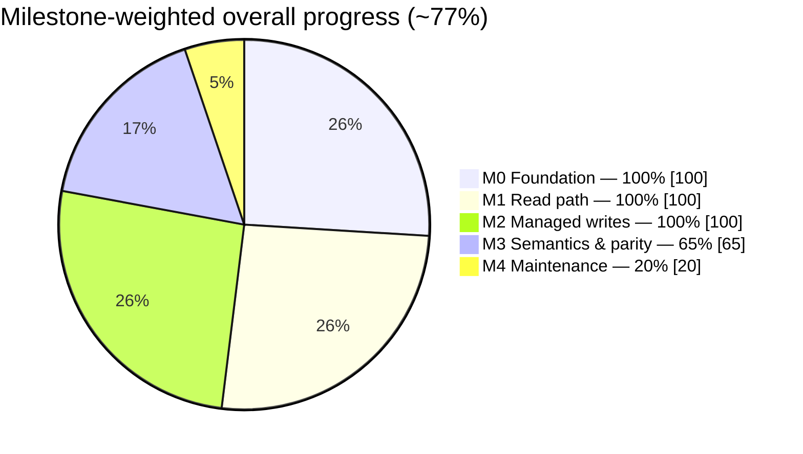
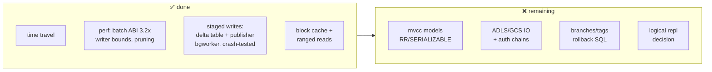

# PROGRESS.md — visual tracker (update at every slice/milestone landing)

*(Living tracker, 2026-11-21. Percentages are working estimates anchored
on the ROADMAP (12-roadmap.md), spec 15 §7 prerequisite chain, doc 14
slices, and the 13-review blocker ledger. Update protocol: append a
HANDOFF entry AND touch this file in the same commit when a slice or
milestone lands.)*

## 1. Milestone completion

| Milestone | Progress | Remaining |
|---|---|---|
| **M0** Foundation | 100% ✅ | — |
| **M1** Read path (REST, FDW, S3, types, time travel) | 100% ✅ | — |
| **M2** Managed writes (TableAM, COW DML, MERGE, ceremony) | 100% ✅ | — |
| **M3** Semantics & cloud parity | ~65% 🔶 | MVCC models · ADLS/GCS IO + auth · branches/tags SQL · logical-repl decision |
| **M4** Maintenance & hardening | ~20% 🔶 | compaction/expire/orphan/ANALYZE + optimize exec (designed, doc 08) |
| **M5** Seamless layer | ongoing | engine integrations |

## 2. Current milestone (M3) detail

## 3. Track-by-track

| Track | Progress | Detail |
|---|---|---|
| Staged writes (spec 15 R2) | 85% ✅ | P0–P4c + R2 core all landed (PRs #5/#6/#9); left: polish + coalesce edge cases |
| v3 conformance (doc 14) | 50% 🔶 | V0/V1/V2 ✅ — V3 (DV write) V4 (lineage) V5 (defaults) remain |
| 13-review blockers | ~80% ✅ | #1 #5 #6 #7 #8 done; #2/#3 partial (writer-side), #4 partial (identity partitions) |
| CI/CD (doc 10 §1a) | ~75% ✅ | all-branch datalake-ci ✅ docs-sentinel ✅ · sanitizer/coverage jobs ❌ |
| Perf (13-review E) | ~80% ✅ | batch ABI ✅ bounds ✅ · P0b ranged+cached+projection-pruned opens ✅ (#17) · P0b2 page-index pruning ❌ P0b3 row-group-deferred ❌ |

## 4. Recently landed (reverse-chronological, evidence in HANDOFF)

| Date | Slice | PR |
|---|---|---|
| 2026-11-21 | P0b ranged/cached/projection-pruned parquet opens (laziness + repeat-free proven) | #17 |
| 2026-11-21 | CI: cargo audit gate + smart path filtering (docs-only skips code jobs) | #16 |
| 2026-11-21 | object_store 0.11→0.14.2 — RUSTSEC-2026-0194/-0195 cleared | #15 |
| 2026-11-21 | Pre-commit hygiene gate: pgindent (fork typedefs) + fmt/clippy pedantic | #13 |
| 2026-11-21 | Staged-publish acceptance pin (2 segs → 1 snapshot, live) | #13 |
| 2026-11-21 | parquet/arrow 60.1.0 lockstep bump + spec 15 §6.3a/§6.5 v60 alignment | #14 |
| 2026-11-21 | Staged-publish acceptance pin (2 segs → 1 snapshot, live) | #13 |
| 2026-11-21 | Hash-key aliasing fix: per-row staged-capture regression ROOT-CAUSED | #9 |
| 2026-11-21 | R2: CREATE-time write_mode + never-misread guard | #9 |
| 2026-11-21 | P4c publisher bgworker (hands-off, live) | #6 |
| 2026-11-21 | P3/P4 core: delta table, staged INSERT, coalesced publisher, crash test | #5 |
| 2026-11-21 | P3 foundation: delta-segments store as PG table | #4 |
| 2026-11-21 | P2 GUCs (32MB/4GB/128MB) · P0 caches · P1 rollover | #3/#2 |
| 2026-11-21 | M3-R2 writer min/max bounds (pruning live) | PR #5-lineage |
| 2026-11-21 | M3-R1 typed batch ABI (3.2×) + corruption fix | PR #5-lineage |
| 2026-11-21 | Specs 15/§1a/01-diagrams; RULES §1a; branch protection; repo rename | #1/#8 |

## 5. Next queue

1. **P0b4 metadata elision** — PROMOTED to first: measured evidence
   (10-testing §5.2 internal receipts) shows count(*) ships ALL 23
   columns × 28.8M rows across the FDW boundary, 100% CPU in transport,
   zero I/O wait — the fetch side is done, the planner is the gap.
   Planner-level COUNT/MIN/MAX from cached footers + manifest
   record_counts (spec 15 §6.6); includes row_count column on the
   delta ledger
2. **P0b3** — row-group-deferred batch iteration (P0b's open_internal
   still collects batches eagerly; laziness is per-column/per-scan) —
   the q3-class full-scan canary needs this + P0b4
3. **P0b2** — cached page indexes + bloom-filter reads through the same
   block cache (parquet ≥60 building blocks; spec 15 §6.3a) — selective
   page-level pruning
4. **M3 close-out** — MVCC models → ADLS/GCS IO + auth → branches/tags →
   logical-repl decision (gate: 4-store CI matrix + isolation tests)
5. **M4** — compaction/expire/orphan/ANALYZE on the P4c worker skeleton;
   optimize exec tiers (design: doc 08); writer-gated encodings (ALP,
   bloom filters — downstream-decoder gate, spec 15 §6.5)
6. **object_store follow-ups** — DONE 0.14.2 in #15 (RUSTSEC cleared,
   cargo audit in CI); remaining: CRC64NVME checksummed writes +
   read-timeout wiring when StorageIo hardening resumes
